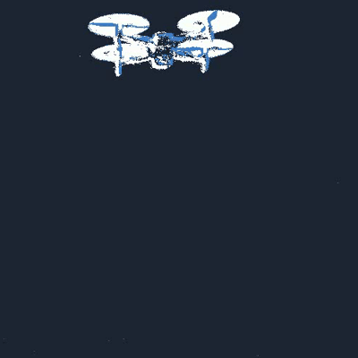

# Event Drone Forecast

**基于事件相机的四旋翼五圆建模与二维短时预测研究原型。**

本项目围绕“机体参考点＋四个桨盘”的几何先验，研究在四桨、部分桨盘和近侧视条件下，
如何保留可观测信息，并结合桨叶周期代理与未知合力反馈预测未来 **0.1 / 0.2 / 0.4秒** 的图像位置。
输入是原生ON/OFF事件，不使用灰度强度重建。



这是 **v0.4.0-alpha.1 源码预览版**，不是论文官方代码、已验证的真实推力系统或SOTA结果。
先看 [方法与贡献](event-drone-forecast/docs/METHOD.md)、[结果与限制](event-drone-forecast/docs/RESULTS.md)、[模型获取条件](event-drone-forecast/docs/MODEL_CARD.md)。

## 主要功能

| 模块 | 当前实现 |
|---|---|
| 原生事件前端 | ON/OFF计数阈值抑制、轮廓拟合、凹曲率拆分与当前强弧支持 |
| 五圆共享模型 | 四桨初始化；三桨条件补全；两点的部分信息更新；轴线退化与短时续接 |
| 可见性切换 | 当前观测、先验条件估计、隐藏桨心明确区分；一桨/不可见也是允许的观测失败 |
| 物理预测原型 | `a_image = k * u + d`：相对频率平方与图像法线形成u，位置残差慢修正d |
| 缺测与对照 | 总加速度最多保持120ms；运动学对照可显式开启，默认不运行传统并行预测 |
| 空间相位实验 | 共享几何矫正＋批量复数矩FFT；检查旋转相位并抑制静态共同闪烁 |

图像模型中心不是已验证的物理质心；两点/侧影不能唯一恢复三维平面或推力。
隐藏桨心不会作为新观测，也不会填成测得的转速。


## 不需要硬件的快速演示

源码位于仓库的 `event-drone-forecast/` 子目录。Python 3.11或更新版本，从仓库根目录执行：

```text
cd event-drone-forecast
python -m pip install -e .
python forecast.py doctor --base-only
python forecast.py demo --output outputs/demo_01
python -m unittest discover -s tests -v
```

演示调用实际五圆、相位和缺测保持代码，包含已知100Hz旋转、共同平面摆动、随机时序和共同闪烁反例。
它验证机制，不代表真实飞行精度。无需相机、RAW、模型权重、SDK或CUDA。

## 使用自己的RAW

以下命令均在 `event-drone-forecast/` 子目录执行。

当前完整RAW入口在 **Windows、Metavision SDK、NVIDIA CUDA** 环境做过本机小段试验，
处理原生 **1280×720** 数据。数据、SDK和检测权重不随包提供。

1. 按 [安装与运行](event-drone-forecast/docs/GETTING_STARTED.md) 配置SDK/GPU环境。
2. 复制 `configs/runtime.example.json` 为 `configs/local.json`，填写兼容权重与SHA256。
3. 先运行doctor，再运行预测：

```text
python forecast.py doctor --config configs/local.json
python forecast.py predict --config configs/local.json --raw data/event.raw --output outputs/run_01 --start 26 --duration 2 --preview
```

输出 `predictions.jsonl`、`protocol.json`、`summary.json`；`--preview`另存视频。
空间相位FFT仍是独立实验，没有默认替换SDK周期链路。当前是文件回放接口，不是实时相机驱动。

## 当前证据

同一侧视小片段、13个相同预测起点的0.4秒目标：

| 方法 | 平均误差 | 中位误差 | P95误差 |
|---|---:|---:|---:|
| 旧物理规则，同输入控制 | 53.899px | 56.601px | 85.371px |
| 当前累计物理规则 | 52.718px | 45.006px | 89.447px |
| 离线运动学控制 | 35.929px | 35.868px | 66.849px |

**物理规则有小幅改进，但仍落后于运动学对照，尾部误差也有回退。**
这些是历史已暴露的稀疏人工框中心参考，不是独立质心/RPM/姿态真值或未知录像盲测。
清晰/侧视两段的平均计算能力约30.8/36.1FPS；源更新率约28.9/29.8Hz，
不能据此声明持续低延迟30FPS。视频播放FPS也不是处理FPS。

见 [演示视频](event-drone-forecast/examples/README.md)、[完整结果口径](event-drone-forecast/docs/RESULTS.md) 和 [指标记录](event-drone-forecast/examples/metrics.json)。

## 项目贡献与已有工作

项目贡献是：将五圆先验、可见性改变时的信息分工、当前残弧约束、条件周期/推力代理及因果反馈组织成可检查的原型，
并保留对照、失败结果和可复现机制演示。**不宣称五圆图形、椭圆拟合、Kalman、扰动观察器或相位测速本身首创。**

主要参考 [Relative State Estimation using Event-Based Propeller Sensing](https://arxiv.org/abs/2604.18289)、
[HelixTrack](https://arxiv.org/abs/2603.09235)、[CoHelix](https://arxiv.org/abs/2610.31384)、
[EventPro](https://arxiv.org/abs/2511.13100)。各自作用、源码复用范围见 [相关工作](event-drone-forecast/docs/RELATED_WORK.md)。

## 许可、引用与开发说明

本**集成发布版采用AGPL-3.0-only**。原有MIT版权声明及FilterPy等第三方许可保留，见
[完整许可证](event-drone-forecast/LICENSE)、[NOTICE](event-drone-forecast/NOTICE.md) 和 [第三方说明](event-drone-forecast/THIRD_PARTY_NOTICES.md)。SDK、CUDA和检测权重不随本许可证重新授权。
ONNX导出不自动豁免上游模型许可。示例媒体的授权范围见 [示例媒体说明](event-drone-forecast/examples/README.md)。

请用 [CITATION.cff](event-drone-forecast/CITATION.cff) / [CITATION.bib](event-drone-forecast/CITATION.bib) 引用软件版本；同时引用实际借鉴或使用的上游工作。
项目开发使用AI编码工具辅助实现、资料检索和文档整理，维护者负责设计取舍、结果核验和公开声明；
不能把AI生成文本或推测当作实验真值。

这是研究与学习工具；真实RPM、牛顿推力、三维姿态、未知录像泛化和部署可靠性仍待验证。

准备发布本仓库时可直接使用 [GitHub发布文案](event-drone-forecast/GITHUB_PUBLISH.zh-CN.md) 与 [Release说明](event-drone-forecast/RELEASE_NOTES.md)。
