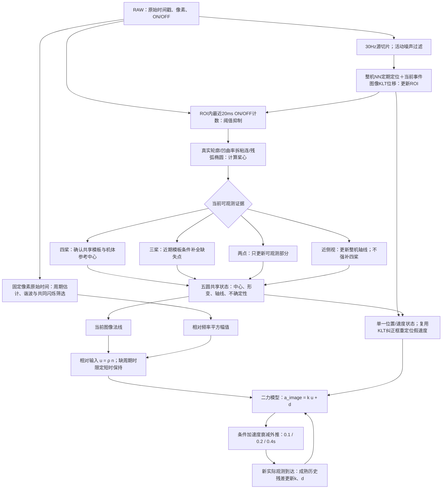
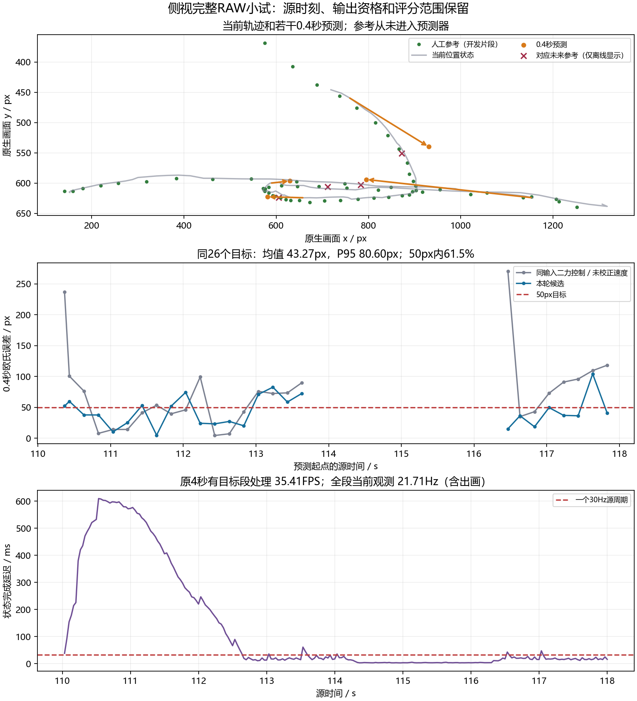

# Event Drone Forecast

**基于原生ON/OFF事件的四旋翼五圆建模与二维短时预测研究原型。**

以“机体参考点＋四个桨盘”为共享几何先验，根据四桨、三桨、两点和侧视轴线的可观测信息切换更新，
结合桨叶周期代理和未知合力反馈，预测未来 **0.1 / 0.2 / 0.4秒** 的图像位置。
不使用灰度重建。整机检测器提供ROI，默认不运行传统方框并行预测器。

这是 **v0.4.0-alpha.2 源码预览版**。不是引用论文官方代码、真实推力测量系统或SOTA声明。
完整RAW需要外部SDK、GPU环境和兼容检测权重；**参考权重尚无公开下载地址**，见 [模型说明](docs/MODEL_CARD.md)。
不具备这些条件也可运行合成演示。


## 当前完整流程



分支条件、代码对应、默认/候选差别见 [完整流程说明](docs/CURRENT_PIPELINE.md)。
侧影轴线不等于测出两个电机；隐藏点不是观测；两点不能唯一恢复三维姿态。
相对频率输入不是牛顿推力，机体参考中心也不是已验证的物理质心。

## 快速开始

```text
python -m pip install -e .
python forecast.py doctor --base-only
python forecast.py demo --output outputs/demo_01
python -m unittest discover -s tests -v
```

真实RAW见 [安装与运行](docs/GETTING_STARTED.md)。保留原配置入口：

```text
python forecast.py predict --config configs/local.json --raw data/event.raw --output outputs/baseline_01 --profile baseline
```

新版联合候选：

```text
python forecast.py predict --config configs/local.json --raw data/event.raw --output outputs/candidate_01 --profile candidate --sdk-avx2 --no-frame-verification
```

`--sdk-avx2`需另行本地构建和合法SDK；未构建时去掉该项，不能照搬对应性能数字。
候选启用JIT、运动复用、同窗二力、短幅值桥、切向未知项和结构指导NN刷新。
基线入口不默认启用该组合。帧哈希会增加开销，计时与功能核验分别披露。

## 最新开发结果

误差为预测中心与稀疏人工框中心的二维欧氏距离，单位像素。均为已暴露的自采开发片段。

| 片段 | 0.4秒目标数 | 平均误差 | P95 | 50px内比例 |
|---|---:|---:|---:|---:|
| 侧视110–118秒 | 26 | 43.27px | 80.60px | 16/26 |
| 原固定110–114秒 | 18 | 43.74px | 75.60px | 不是额外独立片段 |
| 另一录像40–46秒 | 15 | 62.65px | 124.00px | 6/15 |
| 清晰26–28秒 | 未独立评分 | — | — | — |

原固定侧视段处理能力35.41FPS；清晰段32.94FPS、当前观测29.10Hz。
初期仍可积压约610ms；全8秒50.12FPS包含无目标轻负载，不能称持续检测50FPS。
**目标尚未全面完成**：均值达标不代表每次达标，未证明全程低延迟30FPS或未知录像泛化。

同一最新侧视输入，关闭运动复用74.30px，复用运动45.20px，再加同窗二力44.50px，
再加切向反馈43.27px。该对照不是旧版ZIP或传统运动学模型的成绩，不能据此宣称物理模型优于运动学。
见 [结果与失败记录](docs/RESULTS.md)、[机器可读汇总](examples/metrics.json)。



## 项目贡献、来源与发布边界

项目探索重点是**五圆共享模型在桨盘可见性变化时的信息分工、退化续接，以及与条件周期输入和未知合力反馈的组合**。
不宣称五圆图形、椭圆拟合、KLT、Kalman、相位测速、扰动观察器本身首创，
也未证明真实RPM/推力、完整三维姿态或论文级性能。

参考论文与实际代码复用见 [RELATED_WORK](docs/RELATED_WORK.md)，可观测性见 [METHOD](docs/METHOD.md)。
默认不运行传统并行预测；`--kinematic-control`仅显式研究对照。
空间相位FFT保留为独立实验，尚未替换当前周期输入。

**集成发布版采用AGPL-3.0-only**，完整 [LICENSE](LICENSE)、原MIT及FilterPy通知均保留，
详见 [NOTICE](NOTICE.md)、[第三方来源](THIRD_PARTY_NOTICES.md)。
SDK、CUDA、数据、权重与媒体不因本仓库许可而被重新授权。
源码包不包含RAW、权重、SDK头文件/DLL或本地编译二进制。

开发使用AI编码工具辅助实现、检索和文档整理，由维护者负责核验与公开声明。
引用请用 `CITATION.cff` / `CITATION.bib` 并保留实际使用的上游引用。
[发布说明](RELEASE_NOTES.md) · [GitHub更新步骤及可复制文案](GITHUB_PUBLISH.zh-CN.md)
